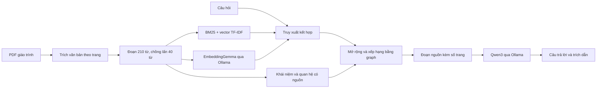

# Tra cứu giáo trình Nhập môn Công nghệ phần mềm

Ứng dụng FastAPI với giao diện tiếng Việt, tìm kiếm nguồn và hỏi đáp bằng Ollama chạy trên máy. Dữ liệu là **Nhập môn công nghệ phần mềm.pdf** của Trần Đình Quế và Nguyễn Mạnh Hùng ở thư mục cha. Không cần API key.

## Chạy trên máy này

Mở terminal trong thư mục `giaotrinh-rag`. Môi trường Python, Ollama và dữ liệu đã được chuẩn bị trong dự án.

```bash
./start.sh
```

Lệnh này khởi động Ollama nếu cần rồi chạy FastAPI. Mở **http://127.0.0.1:8000**; nhấn `Ctrl+C` để dừng các dịch vụ do lệnh này khởi động. Nếu muốn điều khiển từng dịch vụ riêng, dùng hai terminal như sau.

Terminal thứ nhất:

```bash
./run_ollama.sh
```

Terminal thứ hai:

```bash
./run.sh
```

Mở **http://127.0.0.1:8000**. API tương tác: **http://127.0.0.1:8000/docs**. Dừng từng dịch vụ bằng `Ctrl+C`. Nếu Ollama đã chạy ở cổng 11434, chỉ cần khởi động web.

Chọn câu hỏi gợi ý hoặc nhập câu hỏi; chọn chương nếu cần. Bật “Tổng hợp bằng Ollama” để nhận giải thích có trích dẫn. Tắt để chỉ tra cứu các đoạn nguồn. Chọn “RAG cơ bản” hoặc “Có đồ thị tri thức” để so sánh trên cùng câu hỏi. Trong bản đồ tri thức, chọn nút để xem các trang nguồn. Nhấn “Xem trang gốc” để đối chiếu PDF.

## Cấu trúc mô hình



- **Sinh câu trả lời:** `qwen3:1.7b`, cấu hình mặc định phù hợp để thử trên CPU. Có thể đổi sang mô hình lớn hơn trong `.env` nếu máy đủ tài nguyên.
- **Chọn ngữ cảnh:** với câu hỏi về các bước hoặc thứ tự thực hiện, ưu tiên mục có tiêu đề khớp tên quy trình và giữ đầy đủ phần bước thực hiện; tránh trộn với một phương pháp lân cận chỉ vì cùng nhắc đến khái niệm.
- **Đầu ra có cấu trúc:** yêu cầu Ollama trả JSON; mỗi đoạn giải thích có danh sách ID nguồn. Máy chủ kiểm tra các ID rồi định dạng trích dẫn `[1]`, `[2]` để giảm trường hợp mô hình bỏ hoặc bịa số trích dẫn.
- **Dense embedding:** `embeddinggemma`, lưu vector chuẩn hóa trên đĩa và xếp hạng cosine bằng NumPy. Có tiền tố riêng cho truy vấn và tài liệu. Không cần một dịch vụ vector database riêng cho một giáo trình.
- **Truy xuất kết hợp:** TF-IDF, BM25, khớp thực thể và dense embedding nếu chỉ mục embedding đã được tạo. Chuẩn hóa cách diễn đạt tương đương (ví dụ “trích xuất” / “trích rút”, “pha phân tích”); bằng chứng ngữ nghĩa đủ mạnh vẫn được xét khi câu hỏi không khớp từ điển khái niệm. Nếu Ollama embedding mất kết nối, kết quả ghi rõ đang dùng tìm kiếm từ vựng.
- **Graph:** từ điển khái niệm chuyên ngành có bí danh Việt/Anh; liên kết đoạn–khái niệm; các liên kết cùng xuất hiện; một tập quan hệ ngữ nghĩa được đối chiếu với cụm từ bằng chứng trong sách. Quan hệ cùng xuất hiện **không** được coi là quan hệ nhân quả hoặc phân loại. Quan hệ ngữ nghĩa hiện được xây bằng quy tắc có kiểm chứng, chưa tự động trích xuất bằng LLM.
- **Hai chế độ so sánh:** cùng một bộ truy xuất ban đầu; chế độ graph thêm mở rộng qua khái niệm và quan hệ, rồi xếp hạng lại. Đây là triển khai lấy cảm hứng từ KG²RAG, **không phải bản tái hiện đầy đủ bài báo**.
- **Dẫn nguồn:** lưu ID đoạn, chương, trang PDF và số trang in trong sách được đọc từ chân trang. Bổ sung cửa sổ tiếp nối trên cùng trang để tránh cắt mất định nghĩa hoặc bước thực hiện; `context_chunk_ids` ghi các đoạn cấu thành nguồn. Không suy ra số trang bằng một hằng số lệch. Phần mục lục và các phần câu hỏi ôn tập được tách khỏi nguồn trả lời.
- **Không huấn luyện lại LLM:** RAG lập chỉ mục giáo trình và cung cấp ngữ cảnh lúc hỏi; không fine-tune trọng số của Qwen3.

## Dữ liệu và mã nguồn

```text
app/
  main.py          FastAPI và các endpoint
  corpus.py        Đọc PDF, nhận diện chương, chia đoạn, dựng graph
  concepts.py      Từ điển khái niệm và chuẩn hóa tiếng Việt
  retrieval.py     Truy xuất kết hợp và mở rộng qua graph
  generation.py    Ollama chat, trích dẫn và chế độ trích đoạn dự phòng
  static/          Giao diện HTML, CSS, JavaScript
scripts/
  build_index.py   Tạo chỉ mục và embedding
  pull_models.py   Tải mô hình đã cấu hình qua Ollama
  evaluate.py      So sánh truy xuất trên bộ câu hỏi nhỏ
  check_browser.py Kiểm tra Chrome qua DevTools
data/
  index/           Chỉ mục và vector được tạo tự động, không đưa vào Git
  evaluation.json  Câu hỏi và các trang bằng chứng tham chiếu
tests/             Kiểm thử tích hợp và kiểm thử truy xuất
```

## Tạo lại chỉ mục

Sau khi khởi động Ollama:

```bash
.venv/bin/python scripts/pull_models.py
.venv/bin/python scripts/build_index.py --rebuild --embeddings
```

Khởi động lại web sau khi tạo embedding. Nếu quá trình embedding bị gián đoạn, chạy lại cùng lệnh **không có `--rebuild`** để tiếp tục từ checkpoint:

```bash
.venv/bin/python scripts/build_index.py --embeddings
```

Khi đổi PDF hoặc `EMBED_MODEL`, chỉ mục embedding cũ không được sử dụng nếu không khớp dấu vân tay tài liệu, phiên bản bộ chia đoạn và tên mô hình. Thay `PDF_PATH` trong `.env` nếu đổi vị trí tài liệu. Bộ nhận diện chương hiện ưu tiên cấu trúc giáo trình tiếng Việt `CHƯƠNG n`; từ điển và các quan hệ khởi tạo được thiết kế cho giáo trình này.

## Cài mới ở máy khác

Yêu cầu Python 3.11 trở lên, Ollama và PDF gốc. Có `pdftotext` thì ứng dụng ưu tiên dùng công cụ này; nếu không, dùng `pypdf`.

```bash
python3 -m venv .venv
.venv/bin/python -m pip install -r requirements.txt
cp .env.example .env
```

Cài Ollama theo [hướng dẫn Linux chính thức](https://docs.ollama.com/linux) hoặc ứng dụng phù hợp với hệ điều hành; khởi động Ollama, chạy `pull_models.py`, tạo embedding rồi chạy web. Lần tải đầu cần mạng; sau khi mô hình đã có, việc hỏi đáp với cấu hình localhost chạy cục bộ. `requirements-lock.txt` ghi lại các phiên bản đã dùng trên máy hiện tại; `requirements.txt` dùng khoảng phiên bản để hỗ trợ các bản Python khác.

## Kiểm thử và đánh giá

```bash
.venv/bin/python -m pip install -r requirements-dev.txt
.venv/bin/python -m pytest -q
.venv/bin/python scripts/evaluate.py --lexical-only
.venv/bin/python scripts/evaluate.py
```

`evaluation.json` có một bộ câu hỏi nhỏ về tra cứu, kết nối kiến thức và câu hỏi ngoài phạm vi. Script báo Hits@5, độ bao phủ **các trang tham chiếu đã chọn**, tỷ lệ không trả nguồn cho câu hỏi ngoài phạm vi và thời gian truy xuất; không gọi mô hình sinh câu trả lời. Bộ này là kiểm tra ban đầu, chưa phải benchmark nghiên cứu: nhãn chưa đầy đủ, chưa đánh giá độc lập và chưa chứng minh graph luôn tốt hơn. Cần bổ sung câu hỏi nhiều bước cùng nhãn chuyên gia cho báo cáo khoa học.

Để chạy kiểm thử giao diện, khởi động web và Chrome với DevTools cổng 9222, sau đó chạy `.venv/bin/python scripts/check_browser.py`. Script kiểm tra desktop, mobile, tra cứu, bộ lọc, graph và trang PDF, lưu ảnh trong `data/screenshots/`. Thêm `--llm` để kiểm tra cả câu trả lời Ollama thật trên giao diện.

## API chính

| Endpoint | Chức năng |
|---|---|
| `GET /api/health` | Trạng thái ứng dụng và chỉ mục dense |
| `GET /api/stats` | Thống kê dữ liệu và các chương |
| `GET /api/models` | Trạng thái Ollama và các mô hình |
| `POST /api/search` | Tra cứu nguồn, không sinh câu trả lời |
| `POST /api/ask` | Tra cứu rồi sinh câu trả lời bằng Ollama |
| `GET /api/graph?concept=use-case&chapter=6` | Graph có giới hạn khái niệm/chương |
| `GET /api/concepts` | Danh sách khái niệm |
| `GET /api/document` | PDF gốc, hỗ trợ đọc một phần tệp |

Ví dụ body cho `/api/ask`:

```json
{"question":"Xác minh và thẩm định khác nhau như thế nào?","mode":"graph","chapter":4,"limit":6}
```

`answer_mode` phân biệt `generated` (AI tổng hợp), `extractive` (chỉ trích nguyên văn khi Ollama lỗi hoặc trích dẫn không hợp lệ) và `no_evidence` (không tìm thấy nguồn). Điểm truy xuất là điểm xếp hạng tương đối, không phải xác suất trả lời đúng.

## Giới hạn cần biết

Ứng dụng xử lý văn bản PDF; hình UML, biểu đồ và công thức dưới dạng ảnh chưa được hiểu bằng mô hình thị giác. Các trang ít văn bản được ghi trong thống kê. Mô hình nhỏ có thể diễn giải sai dù trích đúng số nguồn; kiểm tra trang gốc khi cần. Bộ lọc câu hỏi ngoài phạm vi là heuristic, không phải bộ phân loại đã huấn luyện. Đây là ứng dụng học tập chạy trên localhost.

Tham khảo: [KG²RAG — NAACL 2025](https://aclanthology.org/2025.naacl-long.449/), [Ollama chat](https://docs.ollama.com/api/chat), [Ollama embedding](https://docs.ollama.com/api/embed), [FastAPI](https://fastapi.tiangolo.com/).
