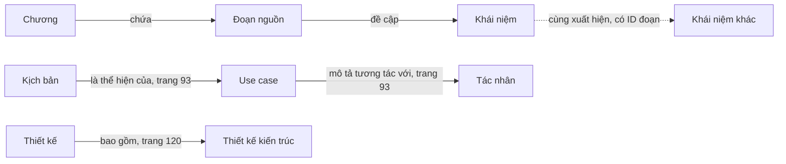

# Thiết kế và hướng đánh giá đề tài

## Bài toán

Tra cứu và hỏi đáp trên giáo trình **Nhập môn Công nghệ phần mềm**, trả lời có trang bằng chứng, hỗ trợ câu hỏi nối kiến thức giữa các chương. Phạm vi hiện tại là một PDF, không truy cập Internet khi trả lời.

## Dữ liệu

Giáo trình có 276 trang và 11 chương. Chương được xác định từ tiêu đề trong phần nội dung; không dùng phần giới thiệu để suy ra tên chương vì cách đánh số tại đó khác nội dung thực tế. PDF được chia theo trang trước, sau đó chia thành các đoạn tối đa khoảng 210 từ với 40 từ chồng lấn. Không ghép nhiều trang thành một đoạn, để trích dẫn trang rõ ràng.

Mỗi đoạn lưu:

```json
{
  "id": "p043-0",
  "pdf_page": 43,
  "printed_page": 42,
  "chapter": 4,
  "chapter_title": "Kiểm thử",
  "text": "…",
  "concepts": ["verification", "validation", "testing"]
}
```

`section` là tiêu đề mục được theo dõi ở mức trang, không phải bộ phân tích vị trí mục chính xác cho từng câu. Giao diện dẫn nguồn chính bằng chương và trang.

## Knowledge graph



Quan hệ chứa và đề cập được lưu qua metadata của đoạn và danh sách `chunk_ids` của khái niệm. Cạnh khái niệm–khái niệm lưu trong `edges`. Các cạnh ngữ nghĩa được tạo từ tập quy tắc đã đọc đối chiếu; chỉ xuất hiện nếu đoạn chứa cả hai thực thể và cụm từ bằng chứng. Việc trích xuất ngữ nghĩa này còn giới hạn, chưa phải bộ trích xuất quan hệ tổng quát.

Không dùng cạnh “cùng xuất hiện” để khẳng định hai khái niệm có cùng ý nghĩa, loại–con, hoặc nguyên nhân–kết quả. Các cạnh đều có ID đoạn để quay lại bằng chứng.

## Truy xuất

1. Chuẩn hóa câu hỏi, nhận diện bí danh khái niệm, mở rộng tên gọi tương đương.
2. Xếp hạng bằng BM25, vector TF-IDF và độ khớp khái niệm có trọng số theo độ hiếm.
3. Nếu có dense index, thêm độ tương đồng cosine từ EmbeddingGemma. Truy vấn và đoạn tài liệu dùng đúng tiền tố tìm kiếm của mô hình.
4. Chế độ cơ bản chọn các kết quả ban đầu. Chế độ graph lấy các khái niệm trong câu hỏi, các quan hệ ngữ nghĩa trực tiếp và những khái niệm ít phổ biến trong đoạn hạt giống để mở rộng ứng viên và cộng điểm graph.
5. Áp dụng giới hạn chương xuyên suốt quá trình. Chọn tối đa một đoạn cho mỗi trang trong danh sách cuối để tăng đa dạng trang nguồn.
6. Chuyển tối đa `CONTEXT_CHUNKS` đoạn đầu vào Qwen3 qua Ollama, yêu cầu trả lời tiếng Việt và dẫn số nguồn.

Đây là mô hình mở rộng một bước với điểm số heuristic; chưa dùng graph neural network, Text2Cypher hoặc community summarization của Microsoft GraphRAG. Vector lưu bằng NumPy; graph lưu bằng JSON có chỉ mục trong bộ nhớ. Với quy mô một cuốn sách, không bắt buộc triển khai Neo4j hoặc một vector database riêng.

## Tính kiểm chứng

- Đầu ra trả về cả câu trả lời và đoạn nguồn đầy đủ.
- Số nguồn do mô hình sinh phải nằm trong phạm vi các đoạn đã cung cấp. Nếu thiếu hoặc có số nguồn không hợp lệ, hệ thống hiển thị trích đoạn gốc và thông báo rõ.
- Kiểm tra trích dẫn hợp lệ **không** chứng minh mọi nhận định được nguồn hỗ trợ. Cần đánh giá độ trung thành với nguồn riêng.
- Nếu không có bằng chứng theo bộ lọc liên quan hiện tại, không gọi LLM.
- Nếu mất kết nối Ollama, tìm kiếm từ vựng và xem nguồn vẫn sử dụng được.
- PDF là văn bản và hình hỗn hợp. Hình UML hoặc công thức dưới dạng ảnh chưa được mô hình hiểu.

## Thiết kế thực nghiệm cho báo cáo

Đối chứng chính: cùng LLM, cùng embedding, cùng PDF, cùng số đoạn ngữ cảnh; chỉ thay đổi có hoặc không mở rộng graph. Dùng cùng cấu hình nhiệt độ và giới hạn đầu ra.

Nên bổ sung ít nhất 60–100 câu hỏi do người đọc giáo trình gán nhãn, chia thành tra cứu đơn, so sánh, nối nhiều đoạn/chương và câu hỏi không có lời giải trong sách. Mỗi câu nên có đáp án tham chiếu cùng các đoạn/trang bằng chứng. Không dùng câu hỏi ôn tập nguyên văn làm toàn bộ tập kiểm tra vì chúng có thể trùng cấu trúc với dữ liệu.

| Khía cạnh | Phép đo đề xuất |
|---|---|
| Truy xuất | Recall@k trên các đoạn được gán nhãn, MRR, độ bao phủ bằng chứng nhiều bước |
| Trả lời | Độ đúng do người đánh giá, mức đầy đủ của các ý cần có |
| Trích dẫn | Tỷ lệ nhận định được nguồn hỗ trợ, độ đúng vị trí trang |
| Từ chối | Khả năng không trả lời khi ngoài phạm vi hoặc thiếu bằng chứng |
| Hiệu năng | Độ trễ truy xuất và sinh câu riêng, RAM và chi phí tải mô hình |
| Phân tích thành phần | Bỏ dense embedding; bỏ quan hệ ngữ nghĩa; chỉ dùng cùng xuất hiện |

Tập `data/evaluation.json` hiện chỉ là bộ kiểm tra nhỏ, có các trang tham chiếu được lựa chọn. Nó giúp phát hiện lỗi triển khai; chưa đủ để kết luận hiệu quả nghiên cứu hoặc công bố mức cải thiện tổng quát.

Tham khảo phương pháp: [Knowledge Graph-Guided Retrieval Augmented Generation, NAACL 2025](https://aclanthology.org/2025.naacl-long.449/).
