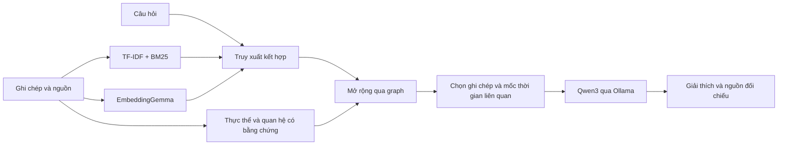

# Kỷ Dậu 1789 · Tra cứu lịch sử bằng RAG + Knowledge Graph

Dự án độc lập về **Quang Trung đại phá quân Thanh**, gồm FastAPI, giao diện tiếng Việt, hỏi đáp bằng Ollama, đồ thị tri thức, dòng thời gian và thư viện nguồn.

## Chạy dự án

Trong thư mục này:

```bash
./start.sh
```

Mở **http://127.0.0.1:8010**. API tương tác: **http://127.0.0.1:8010/docs**. Nhấn `Ctrl+C` để dừng các dịch vụ do lệnh này khởi động.

Môi trường Python, bộ chạy Ollama, hai mô hình và chỉ mục đã được chuẩn bị riêng trong thư mục này. Không cần API key. Mặc định web dùng cổng **8010**, Ollama dùng **11435**. Có thể chạy đồng thời với dự án khác ở cổng 8000/11434. `start.sh` dùng đường dẫn tính từ chính thư mục hiện tại; dữ liệu và cấu hình đều ở trong dự án.

Để quản lý từng dịch vụ riêng, mở hai terminal và chạy `./run_ollama.sh`, sau đó `./run.sh`.

## Dữ liệu đang có

- **20 ghi chép diễn giải** từ **6 nguồn công khai**, đã gắn đơn vị xuất bản và liên kết bài gốc.
- **29 thực thể**, gồm nhân vật, địa điểm, lực lượng, sự kiện và chiến thuật.
- **23 quan hệ có kiểu** với ID ghi chép làm bằng chứng; thêm các cạnh cùng được đề cập để khám phá.
- **7 mốc thời gian**, phân biệt ngày dương lịch và ngày âm lịch theo cách ghi của nguồn.
- **6 chủ đề**: bối cảnh, chuẩn bị, diễn biến, nghệ thuật quân sự, nhân vật và di sản.

Đây là bộ dữ liệu khởi đầu được biên soạn ngắn để thử mô hình. Các ghi chép là diễn giải của dự án, không phải bản sao toàn văn hay nguyên bản sử liệu. Giao diện cho phép đọc ghi chép và mở bài gốc để kiểm chứng. Các bài nguồn là nội dung nghiên cứu/tổng hợp được cơ quan công bố; không đồng nhất với tư liệu đương thời của năm 1789.

Nguồn đã dùng:

1. [Bảo tàng Lịch sử Quốc gia: Quang Trung – Nguyễn Huệ đại phá quân Thanh](https://baotanglichsu.vn/VI/Articles/3097/15721/ky-niem-225-nam-1789-2014-hoang-dje-quang-trung-nguyen-hue-djai-pha-quan-xam-luoc-man-thanh.html).
2. [Báo Điện tử Chính phủ: Chiến thắng hiển hách trong lịch sử chống ngoại xâm](https://baochinhphu.vn/chien-thang-hien-hach-trong-lich-su-chong-ngoai-xam-102138325.htm).
3. [Bảo tàng Lịch sử TP.HCM: Công tác bảo đảm hậu cần](https://www.baotanglichsutphcm.com.vn/ban-tin/cong-tac-bao-dam-hau-can-tran-ngoc-hoi-dong-da-tet-ky-dau-1789).
4. [Bảo tàng Lịch sử TP.HCM: Nghệ thuật tổ chức lực lượng](https://www.baotanglichsutphcm.com.vn/ban-tin/nghe-thuat-to-chuc-luc-luong-trong-tran-quyet-chien-chien-luoc-ngoc-hoi-dong-da-nam-1789).
5. [Bảo tàng Lịch sử Quốc gia: Danh nhân Ngô Thì Nhậm](https://baotanglichsu.vn/vi/Articles/3098/18022/danh-nhan-ngo-thi-nham-1746-1803.html).
6. [Cục Di sản văn hóa: Gò Đống Đa](https://dsvh.gov.vn/go-dong-da-3285).

Các nguồn có cách ghi khác nhau về quân số và tên chỉ huy hướng Đống Đa. Dữ liệu giữ từng cách ghi cùng nguồn tương ứng; hai tên Đô đốc Long và Đặng Tiến Đông có ID riêng. Hệ thống được yêu cầu đối chiếu nguồn khi gặp câu hỏi liên quan, thay vì tự hợp nhất danh tính hay khẳng định một con số duy nhất.

## Cách sử dụng

Nhập câu hỏi hoặc chọn gợi ý. Bật “Tổng hợp bằng Ollama” để nhận câu trả lời AI kèm số trích dẫn; tắt để chỉ tìm ghi chép. Chọn chủ đề để giới hạn dữ liệu. Hai chế độ “RAG cơ bản” và “Có đồ thị tri thức” dùng chung bộ truy xuất ban đầu để so sánh tác động của graph.

- **Bản đồ tri thức:** chọn thực thể, xem quan hệ có hướng rồi mở ghi chép chứng minh từng cạnh. Nét đứt chỉ có nghĩa là cùng được đề cập.
- **Dòng thời gian:** xem trình tự sự kiện và ngày âm/dương riêng biệt; những mốc chưa có ngày cụ thể giữ nguyên mức độ chi tiết của nguồn.
- **Tư liệu & nguồn:** lọc theo bài nguồn, tìm trong các ghi chép, mở bài gốc, tải ghi chép Markdown hoặc toàn bộ dữ liệu JSON.

Ví dụ câu hỏi:

- Nguyễn Huệ lên ngôi ở đâu và vào ngày nào?
- Vì sao quân Tây Sơn lui về Tam Điệp?
- Hà Hồi được hạ vào ngày nào, trước hay sau Ngọc Hồi?
- Quang Trung đánh Ngọc Hồi bằng cách nào?
- Ngô Thì Nhậm có vai trò gì trước và sau chiến thắng?
- Các nguồn ghi quân số Thanh khác nhau ra sao?

## Mô hình



**Embedding:** `embeddinggemma`, vector chuẩn hóa lưu bằng NumPy; tiền tố tìm kiếm riêng cho câu hỏi và tài liệu. **Sinh câu trả lời:** `qwen3:1.7b`, phù hợp để thử trên CPU. Có thể đổi mô hình trong `.env` rồi tải qua `scripts/pull_models.py`.

Graph dùng các quan hệ biên soạn thủ công có bằng chứng. Mỗi cạnh có `evidence` trỏ đến các ghi chép, từ đó truy ra bài nguồn. RAG lập chỉ mục tài liệu và cung cấp ngữ cảnh khi hỏi; không huấn luyện lại trọng số LLM. Không cần Neo4j hoặc một dịch vụ vector database riêng cho bộ dữ liệu hiện tại.

Đối với câu hỏi ngày tháng hoặc trước–sau, bước chọn ngữ cảnh ưu tiên các ghi chép gắn với những mốc thời gian khác nhau để mô hình nhận đủ bằng chứng. Đầu ra Ollama dùng JSON có cấu trúc: từng đoạn giải thích có `source_ids`; máy chủ kiểm tra ID rồi định dạng số trích dẫn. Kiểm tra số nguồn hợp lệ chưa chứng minh toàn bộ câu trả lời đúng; cần đối chiếu nội dung bài gốc khi đánh giá.

## Cấu trúc

```text
app/                  FastAPI, truy xuất, dựng corpus, Ollama và giao diện
data/history.json     Dữ liệu nguồn: ghi chép, thực thể, quan hệ, timeline
data/documents/       Ghi chép theo nguồn, xuất ra Markdown
data/index/           Chỉ mục và vector được sinh riêng cho dự án
scripts/build_index.py
scripts/pull_models.py
scripts/serve.py
scripts/check_browser.py
tests/                Kiểm thử riêng cho dữ liệu và ứng dụng lịch sử
.runtime/             Bộ chạy Ollama và các mô hình của dự án
.venv/                Môi trường Python riêng
.env                  Cấu hình riêng
```

## Bổ sung tài liệu

Thêm bài nguồn vào `sources`, ghi chép vào `records`, thực thể vào `entities` trong `data/history.json`. Mỗi quan hệ phải có ID bằng chứng trong `relations`; các mốc thời gian tham chiếu ghi chép qua `record_ids`. Bộ kiểm tra không chấp nhận nguồn thiếu HTTPS, ID trùng, quan hệ thiếu thực thể hoặc thiếu bằng chứng.

Khi thay đổi dữ liệu, khởi động Ollama rồi chạy:

```bash
.venv/bin/python scripts/build_index.py --embeddings
```

Khởi động lại web để nạp chỉ mục. Dấu vân tay JSON và tên mô hình được kiểm tra trước khi sử dụng vector; thay dữ liệu sẽ không dùng nhầm embedding cũ. Khi chỉ đổi mô hình sinh câu trả lời, không cần tạo lại embedding.

## Cài mới và kiểm thử

Yêu cầu Python 3.11 trở lên và Ollama. Lần đầu tải mô hình cần mạng; tra cứu sau khi tải xong chạy cục bộ với cấu hình mặc định.

```bash
python3 -m venv .venv
.venv/bin/python -m pip install -r requirements-dev.txt
cp .env.example .env
./run_ollama.sh
```

Ở terminal khác:

```bash
.venv/bin/python scripts/pull_models.py
.venv/bin/python scripts/build_index.py --embeddings
.venv/bin/python -m pytest -q
./run.sh
```

Nếu chưa có Ollama, cài theo [hướng dẫn chính thức](https://docs.ollama.com/linux). `run_ollama.sh` ưu tiên bộ chạy trong `.runtime`, sau đó tìm lệnh `ollama` đã cài trên máy. Đổi vị trí máy hoặc bản Python thì tạo lại môi trường `.venv`.

Kiểm tra trình duyệt với Chrome DevTools cổng 9223 và web cổng 8010: `.venv/bin/python scripts/check_browser.py --llm`. Script kiểm tra desktop/mobile, tra cứu, graph, timeline, lọc tư liệu và câu trả lời Ollama thật, lưu ảnh trong `data/screenshots/`.

## API

| Endpoint | Chức năng |
|---|---|
| `GET /api/health`, `/api/stats`, `/api/models` | Trạng thái ứng dụng, chỉ mục, mô hình |
| `POST /api/search` | Tra cứu ghi chép |
| `POST /api/ask` | Tra cứu và tổng hợp bằng Ollama |
| `GET /api/entities`, `/api/graph` | Thực thể và quan hệ có bằng chứng |
| `GET /api/timeline` | Các mốc thời gian |
| `GET /api/documents`, `/api/records` | Nguồn và ghi chép |
| `GET /api/records/{id}` | Nội dung và nguồn của một ghi chép |
| `GET /api/documents/{id}/download` | Tải ghi chép Markdown theo nguồn |
| `GET /api/export` | Tải toàn bộ dữ liệu JSON |

Body ví dụ:

```json
{"question":"Vì sao quân Tây Sơn rút về Tam Điệp?","mode":"graph","category":null,"limit":6}
```

`answer_mode` phân biệt AI tổng hợp (`generated`), hiển thị ghi chép khi mô hình lỗi (`extractive`) và thiếu bằng chứng (`no_evidence`). Điểm xếp hạng không phải xác suất lịch sử đúng. Bộ lọc ngoài phạm vi và bước mở rộng graph hiện là heuristic, cần tập đánh giá lớn hơn cho nghiên cứu.
